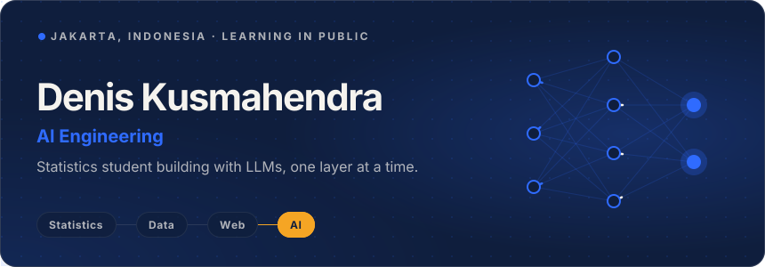

  
  
  
  
  

## 👨‍💼 About Me

👋 Hello! I'm Denis Kusmahendra, a Statistics undergraduate at Jakarta State University focused on **AI Engineering**: building applications powered by large language models.

🤖 I'm currently building LLM apps with Python, FastAPI, Pydantic, and LangChain, such as an API that turns customer reviews into structured sentiment data. Before this, I built end-to-end data analytics projects with SQL, Python, and Power BI, and full-stack websites with Next.js. That background helps me work with data, evaluate model output, and ship working products.

🎥 I also make beginner-friendly SQL and data tutorials on YouTube.

## 🛠 Toolbox

**AI & Backend:**        

**Web:**      

**Data:**       

## 🧭 Journey

Newest first.

### 🤖 AI Engineering

| Project | What it is | Stack |
|---------|------------|-------|
| **[Shopping Agent](https://github.com/deniskusmahendra/shopping-agent)** | AI shopping agent. *In progress.* | `Python` `LLMs` |
| **[Feedback Analyzer](https://github.com/deniskusmahendra/feedback-analyzer)** | API that uses an LLM to turn customer reviews into structured data: sentiment label, 1–5 score, and main theme, validated with Pydantic. | `FastAPI` `Groq` `Pydantic` `PostgreSQL` |

### 🌐 Full-Stack Web

| Project | What it is | Stack |
|---------|------------|-------|
| **[Friend Group Website](https://github.com/deniskusmahendra/friend-group-website)** | [Live](https://friend-group-website.vercel.app) site for my friend group: photo albums, hangout plans, gaming sessions, and badges. | `Next.js` `TypeScript` `Firebase` |
| **[Portfolio Website](https://github.com/deniskusmahendra/deniskusmahendra.github.io)** | My [personal portfolio site](https://deniskusmahendra.github.io). | `HTML` `CSS` |

### 📊 Data Analysis

| Project | What it is | Stack |
|---------|------------|-------|
| **[Demand Forecasting & Inventory Optimization](https://github.com/deniskusmahendra/demand-forecasting-and-inventory-optimization)** | Holt-Winters forecasting and an ABC-XYZ inventory matrix for replenishment planning. | `SQL` `Python` `Power BI` |
| **[Marketing & Conversion Funnel](https://github.com/deniskusmahendra/marketing-and-conversion-funnel)** | GA4 event data in BigQuery to find checkout drop-offs and the best traffic sources. | `BigQuery` `SQL` `Power BI` |
| **[Customer Retention & Segmentation](https://github.com/deniskusmahendra/customer-retention-and-segmentation)** | RFM segmentation and cohort analysis to find high-value customers and track retention. | `Python` `SQL` `Power BI` |
| **[Sales Performance Analysis](https://github.com/deniskusmahendra/sales-performance-analysis)** | Power BI dashboard of sales KPIs, revenue trends, and regional performance. | `PostgreSQL` `Power BI` |

## 🎯 Goals

**Now:** Building LLM-powered apps and AI agents, and learning LangChain, retrieval (RAG), and evaluation ([my coursework](https://github.com/deniskusmahendra/learning-ai-engineering)).

**Next:** Going deeper into the foundations of AI: machine learning, neural networks, deep learning, and natural language processing (NLP), so I understand how the models I build with work, not just how to call them.
